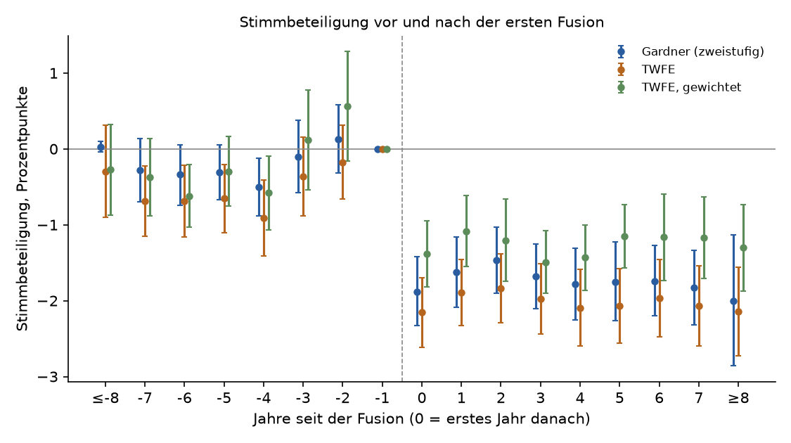
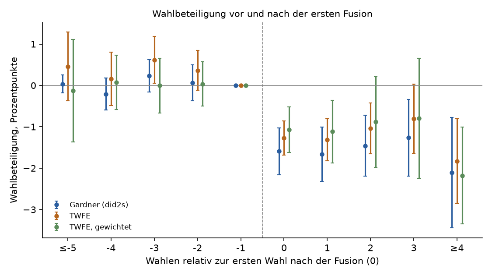

# Senken Gemeindefusionen die politische Beteiligung?

Kurzpapier, Entwurf vom 16.10.2026. Daten: Lab-Datenmodell (öffentlich, Stand in
`ausgabe/modellstand.txt`). Code: `modell_laden.py`, `daten.py`, `analyse.py` (Wahlen),
`daten_abstimmungen.py`, `analyse_abstimmungen.py`, `gardner.py` (Abstimmungen).

## Ergebnis in drei Sätzen

Nach einer Gemeindefusion beteiligen sich weniger Menschen an der nationalen Politik: bei
Nationalratswahlen **1,7 Prozentpunkte** weniger, bei eidgenössischen Abstimmungen **1,9 Prozentpunkte**
weniger als in vergleichbaren Gemeinden desselben Kantons. Zwei getrennte Datenreihen (14 Wahlen
1971–2023, 191 Abstimmungstage 1960–2026, je über 300 Fusionsgemeinden) zeigen dasselbe Muster: kein Rückgang
vor der Fusion, ein Einbruch danach und keine Erholung über acht Jahre. Bei einer Ausgangsbeteiligung von
46–50 % gehen damit 3–4 % der Stimmenden verloren, in kleinen Gemeinden mehr.





## Frage und Einordnung

Zwischen der Wahl 1971 und dem 1.7.2023 sank die Zahl der politischen Gemeinden von 3'068 auf 2'136. Kantone
fördern Fusionen mit Geld und Gesetzen. Ein häufig genannter Preis ist eine schwächere demokratische
Beteiligung. Rochat & Koch (2017) finden für die Schweiz einen stärkeren Rückgang der Wahlbeteiligung in
fusionierten Gemeinden, vor allem in kleinen Orten und nach der ersten Fusion. Studien aus Finnland und
Frankreich finden ähnliche Effekte für Gemeindewahlen.

Diese Studie fragt, ob der Effekt auch bei **nationalen** Wahlen und Abstimmungen auftritt, also dort, wo
die Gemeinde nur der Ort der Stimmabgabe ist. Ein Effekt dort hiesse: Die Fusion schwächt die politische
Beteiligung allgemein, nicht nur das Interesse an der Gemeindepolitik.

## Daten

- **Wahlbeteiligung:** Wählende und Wahlberechtigte der Nationalratswahlen 1971–2023 je Gemeinde
  (BFS, px-x-1702020000_101), vom BFS auf den Gemeindestand vom 1.7.2023 umgerechnet.
- **Stimmbeteiligung:** abgegebene Stimmen und Stimmberechtigte aller 511 eidgenössischen Vorlagen
  1960–2026 je Gemeinde (BFS, px-x-1703030000_101), vom BFS auf den Gemeindestand vom 1.1.2026 umgerechnet.
  Je Gemeinde und Abstimmungstag zählt die Vorlage mit den meisten abgegebenen Stimmen; die Vorlagen
  eines Tages unterscheiden sich kaum (Median der Spanne 0 Punkte, 90 % unter 0,8 Punkten). 1960–1980
  fehlen die Gemeinden von AG, FR und TI.
- **In beiden Reihen** umfasst eine heutige Gemeinde in jedem Jahr dasselbe Gebiet; vor einer Fusion ist
  ihre Beteiligung die der späteren Bestandteile zusammen.
- **Fusionen:** historisiertes Gemeindeverzeichnis des BFS. Eine Fusion ist eine Mutation mit mindestens
  zwei politischen Gemeinden vorher und genau einer nachher. Behandelt ist eine Gemeinde ab der ersten
  Wahl (bzw. dem ersten Abstimmungstag) nach ihrer ersten Fusion. Ein Abstimmungstag, der auf den
  Fusionstag fällt (im Tessin üblich), fällt weg.
- **Grösse der Bestandteile:** Volkszählung 2000, mit `model.gemeinden_umrechnen` auf den Stand 2023 bzw.
  2026 übertragen. Daraus der Anteil der Bevölkerung, deren Gemeinde in einer anderen aufging (für Fusionen
  nach dem 5.12.2000).

Ausgeschlossen: Gemeinden mit Gebietsabtausch oder Teilung (11 bei den Wahlen, 17 bei den Abstimmungen;
keine eindeutige Zuordnung), Courrendlin bis zum Kantonswechsel von Vellerat (30.6.1996, gemischte Kantone),
Moutier (Fusion und Kantonswechsel am selben Tag, 1.1.2026) sowie Gemeinden ohne genügend Beobachtungen
vor der Fusion. Es bleiben 29'272 Wahlbeobachtungen aus 2'103 Gemeinden (316 mit Fusion) und 368'508
Abstimmungsbeobachtungen aus 2'068 Gemeinden (328 mit Fusion).

## Methode

Gestaffelte Differenz-in-Differenzen: Jede Fusionsgemeinde wird mit Gemeinden verglichen, die noch nicht
oder nie fusioniert haben, **im selben Kanton und an derselben Wahl oder Abstimmung** (feste Effekte für
Gemeinde und Kanton × Termin). Damit fallen kantonale Unterschiede weg: Kandidaturen, Vorlagen, die einen
Kanton besonders bewegen, Stimmpflicht in Schaffhausen, Einführung der brieflichen Stimmabgabe. Der Kanton
ist jener am Termin (Jura bis 1978 bei Bern, Laufen bis 1993 bei Bern).

Hauptschätzer ist das zweistufige Verfahren von Gardner (2022): Es schätzt Gemeinde- und
Kanton-Termin-Effekte nur aus unbehandelten Beobachtungen und vermeidet so die bekannte Verzerrung
gewöhnlicher Panelregressionen bei gestaffelter Einführung. Für die Wahlen rechnet `pyfixest.did2s` mit
analytischen Standardfehlern. Für die 368'508 Abstimmungsbeobachtungen bräuchte diese Funktion 18 GB
Speicher; `gardner.py` rechnet dieselben Punktschätzungen speicherschonend und die Standardfehler mit einem
Cluster-Bootstrap über Gemeinden (200 Ziehungen, beide Stufen neu geschätzt). Am Wahlpanel stimmen beide
Wege überein (Wirkung −1,68 beidseits; Standardfehler 0,33 statt 0,36). Zum Vergleich steht die gewöhnliche
Regression (TWFE), ungewichtet und gewichtet.

## Ergebnisse

| Gruppe | Wahlen: Wirkung | 95 %-Intervall | Gemeinden | Abstimmungen: Wirkung | 95 %-Intervall | Gemeinden |
|---|---:|---|---:|---:|---|---:|
| **Alle Fusionen** | **−1,68** | −2,39 bis −0,97 | 316 | **−1,90** | −2,53 bis −1,27 | 328 |
| Unter 1'000 Stimmberechtigte vor der Fusion | −1,99 | −3,13 bis −0,84 | 106 | −2,20 | −3,54 bis −0,85 | 112 |
| 1'000–4'999 Stimmberechtigte | −1,55 | −2,43 bis −0,67 | 166 | −1,92 | −2,44 bis −1,40 | 171 |
| Ab 5'000 Stimmberechtigte | −0,97 | −2,83 bis 0,89 | 44 | −0,66 | −1,76 bis 0,44 | 45 |
| Aufgegangener Anteil unter 20 % (Eingemeindung) | −1,88 | −3,13 bis −0,63 | 84 | −1,50 | −2,36 bis −0,64 | 81 |
| Aufgegangener Anteil 20–39 % | −1,27 | −2,38 bis −0,17 | 61 | −1,52 | −2,57 bis −0,47 | 63 |
| Aufgegangener Anteil ab 40 % (gleichrangig) | −1,97 | −3,16 bis −0,78 | 102 | −1,95 | −2,59 bis −1,32 | 101 |
| Fusionen bis 2000 | −1,80 | −3,14 bis −0,46 | 64 | −2,12 | −3,36 bis −0,87 | 83 |
| Fusionen ab 2001 | −1,61 | −2,35 bis −0,86 | 252 | −1,70 | −2,14 bis −1,26 | 245 |

Wirkung in Prozentpunkten der Beteiligung. Ausgangsbeteiligung der Fusionsgemeinden vor der Fusion: 49,7 %
(Wahlen), 46,0 % (Abstimmungen).

- **Zwei Reihen, ein Befund:** Wahlen und Abstimmungen sind getrennte Daten mit verschiedenen
  Gebietsständen, Zeiträumen und Terminen. Beide ergeben fast dieselbe Wirkung.
- **Vor der Fusion:** Bei den Wahlen unterscheiden sich Fusions- und Vergleichsgemeinden in den fünf Wahlen
  davor nicht (alle Abweichungen unter 0,3 Punkte). Bei den Abstimmungen liegt die Beteiligung in den Jahren
  −7 bis −4 etwa 0,3–0,5 Punkte tiefer als im Jahr vor der Fusion, im Jahr −1 leicht höher (+0,4 gegenüber
  dem Durchschnitt). Das passt zu einer Mobilisierung im Fusionswahlkampf. Lässt man das Jahr −1 als
  Vergleich weg, beträgt die Wirkung −1,82; gemessen an den Jahren −7 bis −4 −1,48. Der Rückgang ist also in
  jeder Lesart deutlich grösser als die Bewegung davor.
- **Dauerhaft:** Bei den Abstimmungen liegt die Beteiligung in jedem der acht Jahre nach der Fusion
  zwischen 1,5 und 2,0 Punkten tiefer; bei den Wahlen zwischen 1,3 und 2,1 Punkten, über mindestens vier Wahlen. Sie
  erholt sich nicht.
- **Kleine Gemeinden stärker:** In beiden Reihen nimmt die Wirkung mit der Grösse ab, von rund −2,1 unter
  1'000 Stimmberechtigten bis −0,7 bis −1,0 ab 5'000 (dort nicht gesichert). Gewichtet nach Stimmberechtigten
  ist die Wirkung darum kleiner (Abstimmungen −1,1 bis −1,5 je Jahr). Das passt zu Rochat & Koch (2017).
- **Auch bei Eingemeindungen:** Wo weniger als 20 % der Bevölkerung ihre Gemeinde verloren, sinkt die
  Beteiligung der ganzen neuen Gemeinde um 1,5 (Abstimmungen) bis 1,9 Punkte (Wahlen). Allein aus den
  eingemeindeten Orten lässt sich das kaum erklären. Wahrscheinlich sinkt die Beteiligung auch in der
  aufnehmenden Gemeinde. Bei den Abstimmungen ist der Effekt bei gleichrangigen Fusionen grösser (−2,0);
  das ist eine Hypothese, die diese Daten nicht direkt prüfen können.
- **Robust:** Lässt man nacheinander jeden Kanton mit mindestens zehn Fusionen weg, bleibt die Wirkung
  zwischen −1,5 und −2,0 (Wahlen) bzw. −1,5 und −2,1 Punkten (Abstimmungen; am kleinsten ohne Thurgau).

## Robustheit (`robustheit.py`, Bootstrap mit 100 Ziehungen)

| Prüfung | Abstimmungen | 95 %-Intervall | Wahlen | 95 %-Intervall |
|---|---:|---|---:|---|
| Hauptschätzung | −1,90 | −2,57 bis −1,23 | −1,68 | −2,33 bis −1,03 |
| Vergleich im selben Bezirk (Bezirk × Termin) | −1,64 | −2,33 bis −0,95 | −1,78 | −2,55 bis −1,00 |
| Bootstrap über Bezirke | −1,90 | −2,67 bis −1,13 | −1,68 | −2,34 bis −1,02 |
| Nur Gemeinden mit genau einer Fusion | −1,84 | −2,55 bis −1,14 | −1,70 | −2,54 bis −0,86 |
| Vollständig beobachtet (Jahre −4 bis 4 bzw. Wahlen −2 bis 2) | −1,79 | −2,41 bis −1,17 | −1,69 | −2,54 bis −0,84 |
| Gestapelte DiD (Cengiz et al. 2019), Gemeinde × Jahr, ±5 Jahre | −1,46 | −1,74 bis −1,17 | | |
| Linearer Vortrend abgezogen (Punktschätzung) | −2,12 | | −1,84 | |
| Jahr vor der Fusion ausgelassen (Punktschätzung) | −1,82 | | | |
| **Placebo: Fusion 4 Jahre (2 Wahlen) zu früh** | **−0,04** | −0,52 bis 0,45 | **−0,19** | −0,84 bis 0,46 |

Alle Schätzungen ausser dem Placebo sind klar negativ, zwischen −1,5 und −2,1 Punkten; das Placebo liegt bei null.
Die Spanne kommt vom leichten Anstieg der Stimmbeteiligung vor der Fusion: als vorübergehende Mobilisierung
gelesen eher −1,5, als fortlaufender Trend eher −2,1. Die Wahlen zeigen diesen Anstieg nicht.

Artikel für ein breites Publikum: `seite/fusionen.html` (aus `seite/vorlage.html` und den Ergebnisdateien mit
`seite/bauen.py` erzeugt).

## Grenzen

- Die Daten zeigen Gemeinden, nicht Personen. Ob dieselben Menschen seltener abstimmen oder ob sich die
  Bevölkerung verändert, bleibt offen.
- Fusionen sind nicht zufällig. Die Vorläufe sprechen gegen unterschiedliche Trends vor der Fusion,
  schliessen aber gleichzeitige Ereignisse nicht aus (z. B. Schliessung von Wahllokalen als Teil der Fusion;
  das wäre eher ein Kanal der Wirkung als ein Fehler).
- Gemeinde- und Kantonswahlen fehlen im Modell; ob der Effekt dort grösser ist, bleibt hier offen.
- Die Grösse der Bestandteile ist nur für Fusionen nach 2000 bekannt (Volkszählung 2000).

## Was das für die Politik heisst

Fusionen werden meist mit Effizienz und Leistungsfähigkeit begründet. Diese Studie beziffert einen
Preis: 3–4 % weniger Stimmende auch bei nationalen Wahlen und Abstimmungen, dauerhaft, besonders in
kleinen Gemeinden. Wer Fusionen plant, kann diesen Preis mit Massnahmen verkleinern, die die Nähe
erhalten: Wahllokale in den alten Ortsteilen, Ortsteilvertretungen, Information über die Stimmabgabe nach
der Fusion. Ob solche Massnahmen wirken, wäre die nächste Frage.

## Quellen

- Rochat, P. & Koch, P. (2017): The effects of local government consolidation on turnout: evidence from
  a quasi-experiment in Switzerland. *Swiss Political Science Review* 23(3), 215–230.
  [ZHAW digitalcollection](https://digitalcollection.zhaw.ch/handle/11475/16794)
- Gardner, J. (2022): Two-stage differences in differences. Arbeitspapier, arXiv 2207.05943; umgesetzt in
  `pyfixest` und in `gardner.py`.
- BFS: Nationalratswahlen nach Gemeinden (px-x-1702020000_101); Volksabstimmungen nach Gemeinden
  (px-x-1703030000_101); historisiertes Gemeindeverzeichnis; Volkszählung.

## Nachrechnen

```bash
uv venv state/analysen-venv --python 3.12
uv pip install --python state/analysen-venv/Scripts/python.exe duckdb==1.4.3 pandas numpy pyfixest matplotlib
state/analysen-venv/Scripts/python analysen/fusionen-wahlbeteiligung/modell_laden.py
state/analysen-venv/Scripts/python analysen/fusionen-wahlbeteiligung/daten.py
state/analysen-venv/Scripts/python analysen/fusionen-wahlbeteiligung/analyse.py
state/analysen-venv/Scripts/python analysen/fusionen-wahlbeteiligung/daten_abstimmungen.py
state/analysen-venv/Scripts/python analysen/fusionen-wahlbeteiligung/analyse_abstimmungen.py  # etwa 30 Minuten
state/analysen-venv/Scripts/python analysen/fusionen-wahlbeteiligung/robustheit.py           # etwa 80 Minuten
state/analysen-venv/Scripts/python analysen/fusionen-wahlbeteiligung/seite/bauen.py
```
